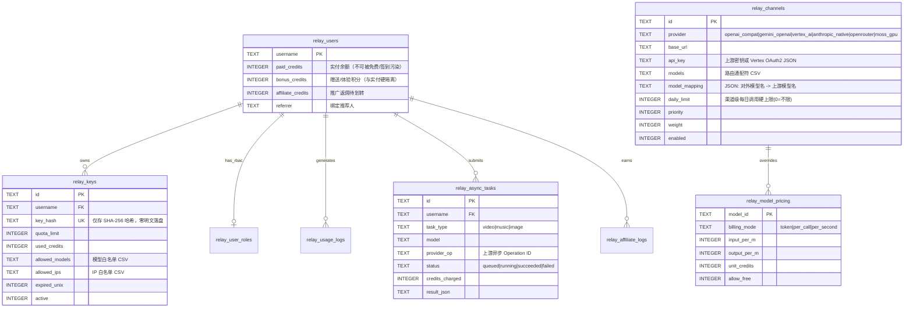

# Lilyco Relay — 数据结构规划与未来扩展性架构

> 本文档回答两个核心工程问题：
> 1. **数据结构如何规划**，才能保证计费零资金漏洞、多协议接入不腐化、且易于横向扩展？
> 2. **未来如何优雅扩展**（新 AI 协议、新计费模式、大流量分布式、垂直业务工坊），做到「开闭原则：加新能力只增文件，不改核心」？

---

## 一、核心数据结构规划（实体关系与不变式）

### 1. 五大领域表分组（对应 `crates/relay-engine/src/ledger/`）

### 2. 三条不可违背的数据不变式（Data Invariants）
1. **双钱包硬隔离不变式**：付费模型（`allow_free = false`）**永远只能扣 `paid_credits`**，绝不允许 `bonus_credits`（赠送/签到积分）混用；推广返佣仅在实付充值（`credit_real_topup` 幂等 `order_id`）后触发。
2. **预扣-结算-全额退款状态机**：任何上游调用前先原子预扣 `pre_hold_paid`，成功则 `settle_hold` 按真实 `usage` 多退少补，失败/超时/429 则 `refund_hold` 100% 退回，确保**零漏扣、零错扣**。
3. **价格单源真相（Single Source of Truth）**：
   - 默认基线：`config/models.toml`（Git 可版本化审计）；
   - 热覆写层：`relay_model_pricing` 表 + 内存 `DashMap`（启动自动加载，后台改价零重启生效，内置成本倒挂预警）；
   - 运行时计算：`ModelConfig::compute_fixed_cost(units)` 与 `PricingRate::calculate_credits(usage)` 全部收口在纯库 `relay-core`，前后端绝不重复硬编码价格。

### 3. 下一步建议演进的数据结构（按需引入，不过度设计）
- **账本流水表 `relay_ledger_entries`（复式记账）**：当日流水超过 1,000 单时引入，每笔充值/预扣/结算/退款/返佣均写入不可变 append-only 流水（`id, username, delta, balance_after, ref_id, reason`），方便财务对账与异常审计。
- **渠道健康指标表 / 内存滑动窗口**：记录每个渠道近 5 分钟的成功率、P95 延迟与 429 频次，实现自适应权重降级。

---

## 二、未来扩展性设计（四个维度开闭原则）

### 1. 协议与上游厂商扩展（Plug-in Adapter）
- **现状**：`relay-engine` 已把 `gemini_adapter.rs`、`vertex_auth.rs` 与 `upstream.rs` 分离。
- **扩展方式**：后续新增 Bedrock SigV4、Azure OpenAI、或私有推理引擎时，在 `relay-engine/src/providers/` 下新增一个实现统一接口的模块（输入 `LiveChannel + ModelConfig + Request`，输出统一响应 + `TokenUsage`），在分发 `match ch.provider.as_str()` 注册一行即可，**无需改动账本、风控或任何前端代码**。

### 2. 计费维度扩展（`BillingMode` 枚举驱动）
- 当前已支持 `Token`（按百万 Token）、`PerCall`（按次）、`PerSecond`（按秒，Veo 防倒挂）。
- 未来若新增 **按分辨率/像素（如 4K 生图）** 或 **按字符数（TTS）**，只需在 `relay-core/src/config.rs` 的 `BillingMode` 枚举新增一个变体并实现 `compute_fixed_cost`，Rust 编译器会强制检查所有 `match` 分支，**编译期杜绝漏算费**。

### 3. 存储与流量扩展（单机 → 多节点平滑演进）
| 阶段 | 日请求量 | 架构形态 | 改动成本 |
| :--- | :--- | :--- | :--- |
| **Phase 1（当前）** | `< 10 万/天` | 单机静态 musl 二进制 + 本地 Turso/SQLite（WAL 模式） | 零运维、低成本 |
| **Phase 2（双进程隔离）** | `10 万 ~ 100 万/天` | 启用已有 `bins/relay-proxy`（转发面 `:8090`）+ `bins/relay-admin`（管理面 `:8091`），Pingap 按路径分流 | **0 代码改动**（二进制骨架已就绪） |
| **Phase 3（分布式集群）** | `> 100 万/天` | Turso Embedded Replica / Postgres 主从 + Redis 分布式限流与渠道冷却状态 | 仅替换 `relay-engine/src/ledger/` 与 `relay-risk/` 实现，上层 HTTP 与 `relay-core` 零改动 |

### 4. 前端与垂直应用解耦（主控制台 vs 实验工坊）
- **核心原则**：**中转网关控制台**（看板、模型广场、令牌、钱包、渠道、价目、风控）保持极致轻量；**重型垂直应用**（YSM 3D / Three.js、MOSS 绘梦、浏览器助手、工作流）全部走 `React.lazy()` 独立异步分包。
- 未来新增任何新垂直应用（如 AI 剪辑、代码 Agent），只需在 `web/src/components/` 新增懒加载模块并挂一个路由入口，**不会拖慢控制台首屏加载，也支持随时整体替换控制台 UI 皮肤**。
